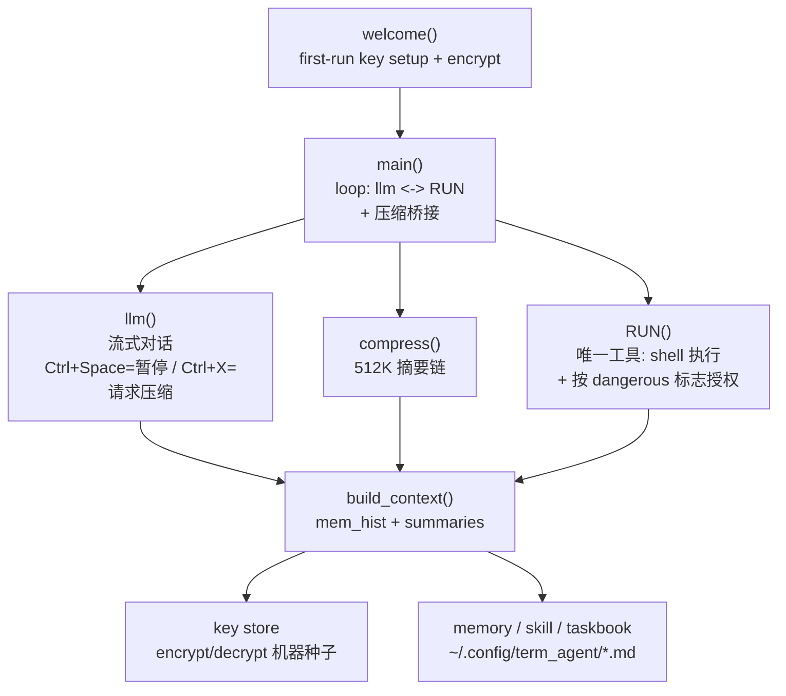
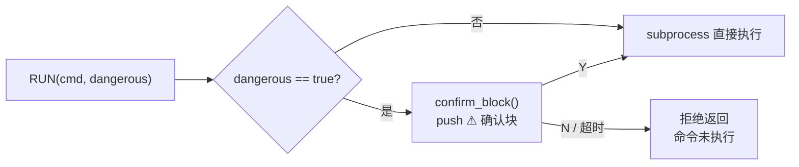

# AGENT IN TERMINAL


超轻量终端内 AI Agent：单文件，DeepSeek 对话 + Shell 工具执行。

## QUICK START

```bash
curl -fsSL https://cdn.jsdelivr.net/gh/Xiyinnnnnn/Agent-in-Terminal@main/install.sh | bash
```

首次运行输入 DeepSeek API Key：
- 加密落盘（`~/.config/term_agent/key.bin`）

## USAGE

```bash
# Linux：python3 ~/.local/bin/term_agent/term_agent.py

# Termux：agent
```

API 端点与模型写在 `term_agent.py` 顶部常量中（`API_URL` / `MODEL` / `MAX_TOK` / `MAX_OUT`），可自行修改。

## KEY BINDINGS 快捷键

| 按键 | 行为 |
|---|---|
| `Ctrl+Space` | 立即暂停当前执行（不退出，回到提示符） |
| `Ctrl+X` | 请求压缩当前上下文（不打断执行；当前步骤自然结束后进入压缩流程） |

> 启动横幅：`新终端=新对话 | Ctrl+Space=暂停 | Ctrl+X=压缩`
> `Ctrl+X` 只设置请求标记，多次按下合并为一次压缩，不立即执行、不中断 LLM / Shell。

## ARCHITECTURE



| 层 | 组件 | 职责 |
|---|---|---|
| ENTRY | `welcome()` | 首次运行引导，Key 加密入库 |
| CORE | `main()` | 主循环：LLM 对话、工具调用解析、结果回填、压缩请求桥接 |
| LLM | `llm()` | 流式 SSE；`Ctrl+Space` 暂停 / `Ctrl+X` 设压缩请求标记 |
| MEM | `compress()` / `build_context()` | 512K(`MAX_TOK`) 阈值压缩，摘要链跨会话延续 |
| TOOL | `RUN()` | 唯一工具：Shell 执行 + `dangerous` 标志授权闸门 |
| SEC | `encrypt/decrypt_key()` | 机器指纹种子加密，Key 不落明文 |

## SECURITY 安全模型

判定权在模型：宿主不扫描命令内容，只按 `RUN` 的 `dangerous` 标志分流。



| dangerous | 行为 |
|---|---|
| `false` | 直接执行，宿主不做二次校验 |
| `true` | 终端 push 确认块（⚠ + 命令全文），`Y` + 回车才执行 |

### 用户授权

| 项 | 值 |
|---|---|
| 超时 | `AUTH_TIMEOUT = 30`，设 `0` = 永不超时 |
| 接受输入 | `y` / `yes` + 回车（单键不算，全角等效） |
| 拒绝 | `N` / 超时 / `Ctrl+C` / `Ctrl+D` |

## NOTES

- 新终端 = 新对话（每个终端会话独立上下文）
- `Ctrl+Space` = 暂停；`Ctrl+X` = 请求压缩

## UPDATE 如何更新

安装脚本是**幂等**的：重复执行安装命令即可覆盖更新程序文件

## LICENSE

MIT

## Extras 扩展

- **Agent-Channel（微信/QQ 遥控通道）**：已独立为单独仓库 → [Xiyinnnnnn/Agent-Channel](https://github.com/Xiyinnnnnn/Agent-Channel)
